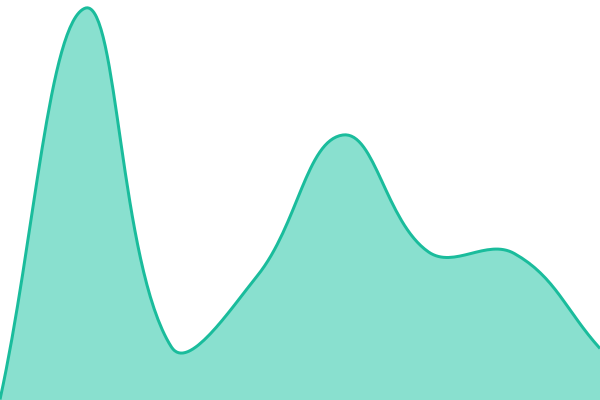
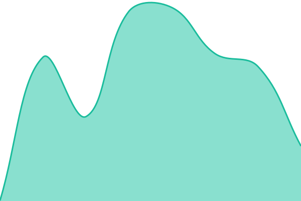

# [📈 Live Status](https://status.nathanzimmerman.com): <!--live status--> **🟩 All systems operational**

This repository contains the open-source uptime monitor and status page for [Nathan Zimmerman](https://nathanzimmerman.com/), powered by [Upptime](https://github.com/upptime/upptime).

With [Upptime](https://upptime.js.org), you can get your own unlimited and free uptime monitor and status page, powered entirely by a GitHub repository. We use [Issues](https://github.com/natezimm/status/issues) as incident reports, [Actions](https://github.com/natezimm/status/actions) as uptime monitors, and [Pages](https://status.nathanzimmerman.com) for the status page.

<!--start: status pages-->
<!-- This summary is generated by Upptime (https://github.com/upptime/upptime) -->
<!-- Do not edit this manually, your changes will be overwritten -->
<!-- prettier-ignore -->
| URL | Status | History | Response Time | Uptime |
| --- | ------ | ------- | ------------- | ------ |
|  [Portfolio](https://nathanzimmerman.com) | 🟩 Up | [portfolio.yml](https://github.com/natezimm/status/commits/HEAD/history/portfolio.yml) | 

 116ms
     
 | 

<a href="https://status.nathanzimmerman.com/history/portfolio">100.00%</a>
    

|  [Know Ball](https://knowball.nathanzimmerman.com/health) | 🟩 Up | [know-ball.yml](https://github.com/natezimm/status/commits/HEAD/history/know-ball.yml) | 

 108ms
     
 | 

<a href="https://status.nathanzimmerman.com/history/know-ball">100.00%</a>
    

|  [Wheelhouse demo](https://calendar.nathanzimmerman.com/health) | 🟩 Up | [wheelhouse-demo.yml](https://github.com/natezimm/status/commits/HEAD/history/wheelhouse-demo.yml) | 

 108ms
     
 | 

<a href="https://status.nathanzimmerman.com/history/wheelhouse-demo">100.00%</a>
    

|  [Rabbit Ears demo](https://rabbitears.nathanzimmerman.com/api/health) | 🟩 Up | [rabbit-ears-demo.yml](https://github.com/natezimm/status/commits/HEAD/history/rabbit-ears-demo.yml) | 

 178ms
     
 | 

<a href="https://status.nathanzimmerman.com/history/rabbit-ears-demo">100.00%</a>
    

|  [Brick Breaker resume](https://resume.nathanzimmerman.com) | 🟩 Up | [brick-breaker-resume.yml](https://github.com/natezimm/status/commits/HEAD/history/brick-breaker-resume.yml) | 

 127ms
     
 | 

<a href="https://status.nathanzimmerman.com/history/brick-breaker-resume">100.00%</a>
    

<!--end: status pages-->

[**Visit our status website →**](https://status.nathanzimmerman.com)

## 📄 License

- Powered by: [Upptime](https://github.com/upptime/upptime)
- Code: [MIT](./LICENSE) © [Anand Chowdhary](https://anandchowdhary.com)
- Data in the `./history` directory: [Open Database License](https://opendatacommons.org/licenses/odbl/1-0/)
